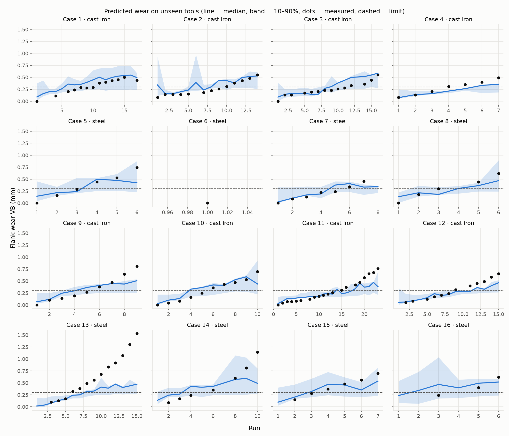
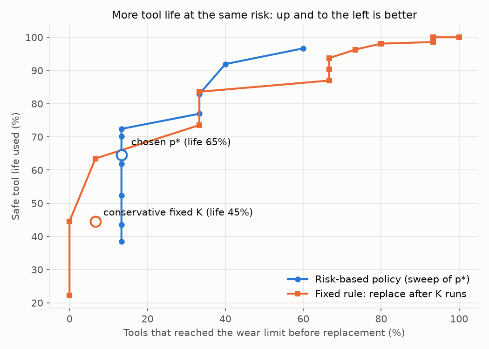
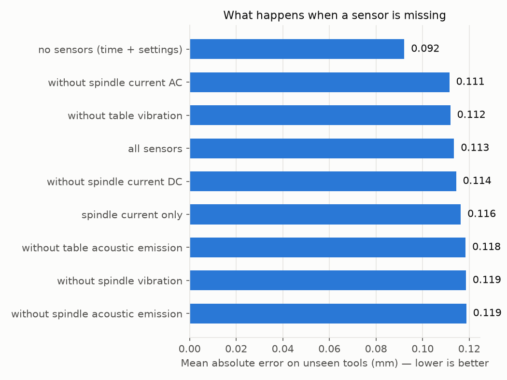

# Risk-based tool-life prediction for CNC milling

**From sensor signals to keep / inspect / replace decisions.**

Cutting tools are usually replaced after a fixed number of cuts, chosen
conservatively so that no tool ever wears out mid-cut. That wastes a lot of
usable tool life. This project predicts tool wear from machine sensor signals,
estimates the *risk* that the tool will pass its wear limit on the next run,
and turns that risk into a recommendation. It then tests, on tools the model
has never seen, whether this uses more tool life than a fixed rule without
more failures.

Author: Gargee Sonawane · Data: NASA Ames Prognostics Data Repository, milling data set (Agogino & Goebel, 2007)

Code written with help from an AI assistant (Claude); experiments run, results checked and interpreted by the author.

---

## Results (NASA milling data, 16 tools, each tested as an unseen tool)

**Headline:** the risk-based policy used **65%** of each tool's safe life, against **45%** for a
conservative fixed replacement rule, but let **2 of 15** tools pass the wear limit against **1 of 15**.
It keeps tools cutting longer, but is not yet safe enough for aerospace use.

### 1. Wear prediction (mean absolute error, lower is better)

| Model | MAE (mm) | RMSE (mm) |
|---|---|---|
| Time-and-settings baseline (wear-growth law, no sensors) | **0.110** | 0.178 |
| Quantile gradient boosting (all sensors) | 0.115 | 0.185 |
| Random forest (all sensors) | 0.133 | 0.204 |
| Ridge regression (all sensors) | 0.139 | 0.204 |

Wear limit: 0.3 mm. Errors are scored only on runs where wear was actually measured (146 points).

### 2. Uncertainty

The 10–90% prediction band contained the measured wear **55%** of the time (target 80%).
The model is overconfident on new tools, mainly because it misses the rapid wear at the end of a tool's life.

### 3. Replacement policy

| Policy | Tools | Failures | Safe life used |
|---|---|---|---|
| Risk-based (replace when risk ≥ 20%) | 15 | 2 | 65% |
| Fixed rule (shortest safe life of the other tools) | 15 | 1 | 45% |

One case never reached the limit and is left out of this test.

### 4. Missing sensors

Removing any single sensor changed the error very little (0.111–0.119 mm vs 0.113 mm with all sensors). This test uses a separately trained median model, so its all-sensor error differs slightly from the 0.115 mm in the first table. 
Gradient boosting with **no sensors** (time and settings only) gave the lowest error, **0.092 mm**.

### What this means

On a small lab dataset, sensor features did not beat a time-and-settings baseline, and the
uncertainty was too narrow for safety-critical decisions. The hard problems are catching late-life
rapid wear and calibrating uncertainty, which need richer data and better uncertainty methods.





---

## Data

16 milling experiments ("cases"), each one tool run until worn, at different
depths of cut, feeds and two materials (cast iron and steel). After each run
the machine logged six signals: spindle motor current (AC and DC), vibration
at the table and spindle, and acoustic emission at the table and spindle.
Flank wear (VB) was measured after some runs, not all.

**Get it:** download `mill.zip` from
<https://data.nasa.gov/dataset/milling-wear>, unzip it, and put `mill.mat` in
the `data/` folder.

## How to run

```bash
python -m venv .venv
source .venv/bin/activate          # Windows: .venv\Scripts\activate
pip install -r requirements.txt

python run_all.py --data data/mill.mat      # about 3–5 minutes
streamlit run app.py                         # interactive demo
```

Options: `--limit 0.3` (wear limit in mm), `--p-star 0.2` (replacement risk threshold).

## Method

| Step | What it does | File |
|---|---|---|
| 1. Load and clean | Read `mill.mat`; drop runs with broken signals | `src/data.py` |
| 2. Labels | Wear is only measured on some runs; for training, interpolate *within* a tool between real measurements. Test scores use **only measured** runs | `src/data.py` |
| 3. Features | For each signal: RMS, std, peak, peak-to-peak, crest factor, kurtosis, skew, and energy in four frequency bands (FFT). Entry and exit of each cut trimmed | `src/features.py` |
| 4. Models | A physics-style baseline (wear as a power law of cutting time, scaled by settings), ridge regression, random forest, and gradient-boosted **quantile** models (10th, 50th, 90th percentile) | `src/models.py` |
| 5. Testing | **Leave-one-case-out**: train on 15 tools, test on the 16th, repeat for all. Splitting by run would leak information between neighbouring runs of the same tool | `src/models.py` |
| 6. Risk | Turn the 10–90% band into a probability that next-run wear passes the limit | `src/risk.py` |
| 7. Decision | keep if risk < 5%; inspect in between; replace if risk ≥ p* | `src/risk.py` |
| 8. Policy test | On each unseen tool, compare tool life used and failures against a fixed rule "replace after K runs", where K is the shortest safe life among the *other* tools (the conservative practice) | `src/risk.py` |
| 9. Missing sensors | Retrain without each sensor, and with spindle current only (a signal every CNC already has) | `run_all.py` |

## Limitations

- Small dataset: 16 tools, lab conditions, cast iron and steel, not titanium.
- Wear is not measured after every run; interpolated labels are used for training only.
- The 10–90% band is not perfectly calibrated with this little data (check the coverage line in `results/summary.md`).
- The decision threshold p* was set in advance, not tuned per tool; the trade-off curve shows all thresholds.
- Cost figures are illustrative assumptions.

## Next steps

- Repeat on the PHM Society 2010 milling data (force, vibration, acoustic emission; closer to "axis forces").
- Test transfer between cutters and materials.
- Better-calibrated uncertainty (for example conformal prediction), to raise coverage from 55% towards 80%.
- Physics-informed model: use the Taylor-style baseline as a prior and let the data-driven model learn the correction.

## Testing the code without the real data

`python tools/make_synthetic_mill.py` writes a **fake** file in the same format
(`data/synthetic_mill.mat`) so you can check the code runs. Its numbers mean
nothing; never report results from it.

## Reference

A. Agogino and K. Goebel (2007). BEST Lab, UC Berkeley. "Milling Data Set",
NASA Ames Prognostics Data Repository, NASA Ames Research Center, Moffett Field, CA.
